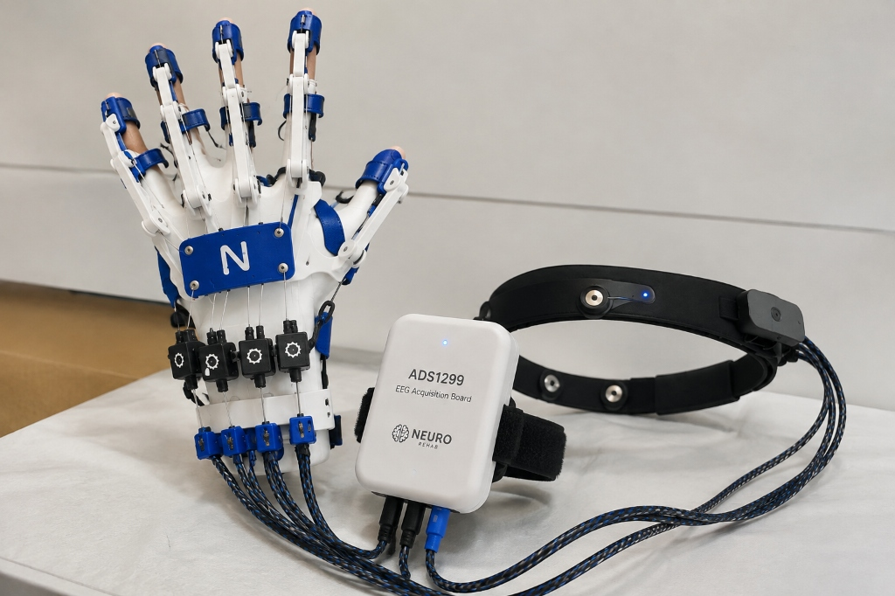
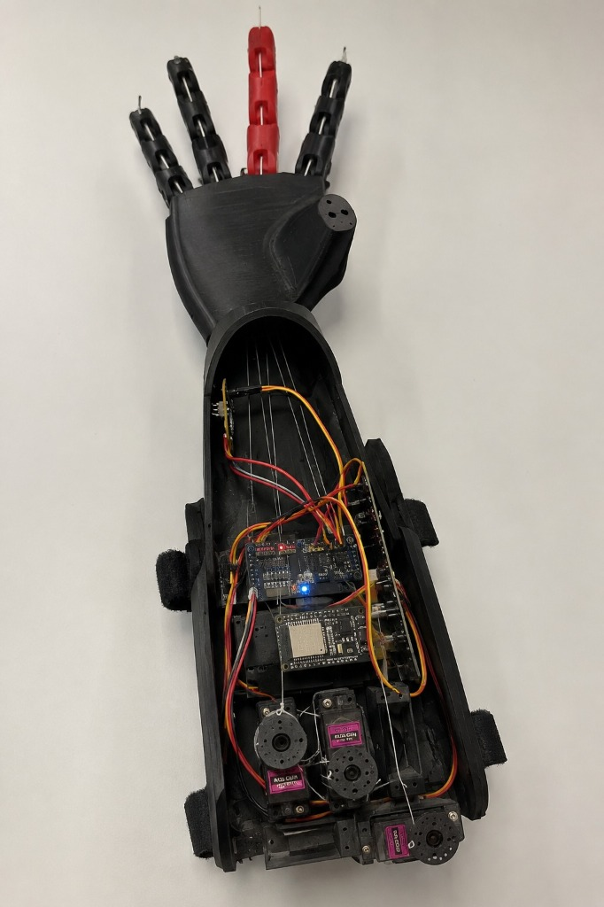
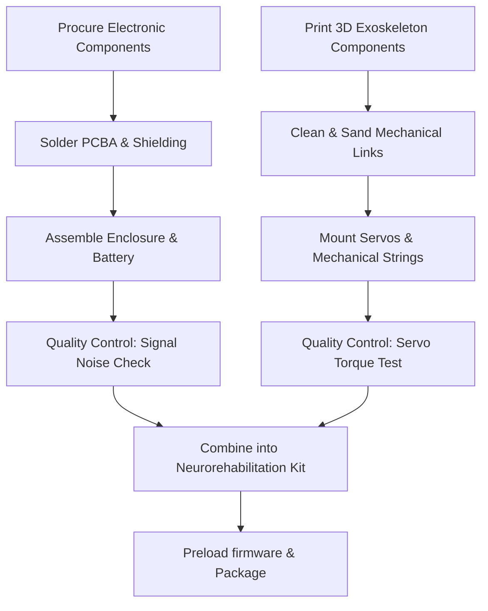

# NeuroStride — Hardware Sourcing & Manufacturing Documentation

> **Document Version:** 1.5.0
> **Status:** Active
> **Created:** 2026-08-11
> **Owner:** Prathmesh (LTPratham)
> **Classification:** Internal — Confidential

---

## 1. Introduction & Objectives

Standard clinical EEG/EMG systems and medical-grade robotic exoskeletons cost between **₹5 Lakhs and ₹50 Lakhs**, making them completely inaccessible to individual households and rural clinics in India.

**NeuroStride** bridges this accessibility gap by developing a custom, low-cost **ADS1299 8-Channel ESP Kit for Modulation**. By sourcing the individual components (including the ADS1299 Analog Front End chip) and fabricating a custom PCB, we bypass the high cost of pre-made commercial modules, keeping the total kit manufacturing cost under **₹12,000** while maintaining a **55%+ gross profit margin**.

---

## 2. Bill of Materials (BOM) — Custom Board & Exoskeleton

Below is the itemized Bill of Materials (BOM) representing the estimated cost to manufacture one unit at pilot-scale production (in INR):

### 2.1 ADS1299 8-Channel ESP Board (BOM)
This unit captures high-precision, low-noise EEG (brain) and EMG (muscle) signals from the patient, processes them on-device, and streams them to the host PC via USB serial. It supports closed-loop modulation and active neural stimulation.

| Component Description | Specifications / Model | Qty | Unit Cost (₹) | Total Cost (₹) | Rationale / Notes |
|---|---|---|---|---|---|
| **Microcontroller** | ESP32-WROOM-32D (Dual-core, 240MHz) | 1 | ₹450 | ₹450 | Handles ADC communication, filtering, and wireless serial transmission. |
| **Analog Front End (AFE)** | ADS1299 (24-bit, 8-channel low-noise ADC) | 1 | ₹5,000 | ₹5,000 | Clinical-grade active biosignal acquisition. High-performance TI chip. |
| **Custom PCB & Assembly** | 4-Layer PCB, SMT assembly (PCBA) | 1 | ₹1,200 | ₹1,200 | Custom routing with analog ground isolation, shielding, and modulation pathways. |
| **Galvanic Isolation** | Digital isolators (ISO7741) & isolated DC-DC converters | — | ₹600 | ₹600 | **Safety Requirement:** Electrically isolates patient electrodes from host PC/power surges. |
| **Power Management** | Ultra-low noise LDOs & TP4056 charging circuit | 1 | ₹250 | ₹250 | Ensures clean, ripple-free analog power rails. |
| **Li-Po Battery** | 3.7V 1200mAh Rechargeable Lithium-Polymer | 1 | ₹250 | ₹250 | Compact battery for wireless, wearable usage. |
| **Electrodes & Cabling** | Active dry EEG/EMG electrodes + shielded cables | 8 | ₹125 | ₹1,000 | Shielded cables and active dry sensors to limit EMI interference. |
| **Enclosure** | 3D-printed / injection-molded ABS case | 1 | ₹300 | ₹300 | Custom ABS box with internal copper tape shield and belt/strap loops. |
| **Headband & Straps** | Adjustable velcro head/arm bands | 1 | ₹100 | ₹100 | Secures the electrodes comfortably to the patient. |
| **Misc (Ports, Switches, LEDs)** | Micro-USB port, power switch, indicators | — | ₹100 | ₹100 | Power and diagnostic feedback controls. |
| **Subtotal (Sensor Board)** | | | | **₹8,800** | |

---

### 2.2 3D-Printed Robotic Exoskeleton Hand (BOM)
This mechanical glove fits over the patient's paralyzed hand and triggers physical flexion/extension.

| Component Description | Sourcing / Model | Qty | Unit Cost (₹) | Total Cost (₹) | Rationale / Notes |
|---|---|---|---|---|---|
| **3D Printing Material** | PLA / PETG Filament (~300g) | — | ₹300 | ₹300 | High-durability structural frame. |
| **Servo Motors** | MG996R High-Torque Metal Gear Servos | 5 | ₹200 | ₹1,000 | Individual servo control for each finger. |
| **Servo Driver** | PCA9685 16-Channel PWM I2C Controller | 1 | ₹150 | ₹150 | Offloads PWM generation from the microcontroller. |
| **Power Supply** | Wearable 5V 3A Rechargeable Li-ion Battery Pack | 1 | ₹600 | ₹600 | **Wearable Requirement:** Portable power source for servos (strapped to arm/waist). |
| **Tensioning Strings** | High-tensile nylon lines / steel wire cords | — | ₹100 | ₹100 | Translates servo rotation into finger pull/flexion. |
| **Mechanical Joints** | Screws, pins, joints, and padding | — | ₹150 | ₹150 | Connects mechanical link elements together. |
| **Velcro Straps & Glove** | Breathable fabric under-glove + straps | 1 | ₹100 | ₹100 | Custom fit adjusting to different hand sizes. |
| **Subtotal (Robotic Hand)** | | | | **₹2,400** | |

---

### 2.3 Manufacturing Cost Summary
* **ADS1299 8-Channel ESP Board Manufacturing Cost:** ₹8,800
* **Robotic Exoskeleton Hand Sourcing Cost:** ₹2,400
* **Total Manufacturing Cost (COGS) per full kit:** **₹11,200**

> [!NOTE]
> By substituting the static wall adapter with a wearable 5V battery pack, the total kit cost is **₹11,200**, remaining fully within the project's target limit of under **₹12,000**.

---

## 3. Retail & Customer Pricing Strategy

NeuroStride generates revenue by selling these custom-manufactured hardware kits directly to clinics (B2B) and home-based patients (D2C):

### 3.1 Purchase Options

1. **ADS1299 8-Channel ESP Board (Stand-alone)**
   * Useful for patients needing only diagnostic tracking or cognitive therapy (EEG-only) without motor actuation.
   * **Retail Price (One-time):** ₹16,000
   * **Gross Profit:** ₹7,200 (45.0% margin)

2. **Complete Neurorehabilitation Kit (Sensor Board + Exoskeleton Hand)**
   * Required for active, intent-triggered physical therapy sessions.
   * **Retail Price (One-time):** ₹25,000
   * **Gross Profit:** ₹13,800 (55.2% margin)

3. **Pediatric Eye-Tracking Integration Accessory (Optional)**
   * Optional B2B integration with the Tobii Eye Tracker 5 for children with cerebral palsy or autism.
   * **Retail Price:** ₹20,000 (third-party hardware resold with integration license)

---

### 3.2 Financing Option (0% Interest EMI)
To remove the barrier of high upfront costs for low-income patients:
* **Stand-alone Board Plan:** ₹1,333/month for 12 months (0% interest, total ₹16,000).
* **Complete Kit Plan:** ₹2,083/month for 12 months (0% interest, total ₹25,000).
* **Gateway Partner:** Integrated via Razorpay or Paytm EMI services.
* **Auto-Debit:** Scheduled on the 1st of each month via UPI Auto-Pay or NetBanking e-Mandates.
* **Default Handling:** If payment fails twice consecutively, the device locks via firmware over-the-air (OTA) controls until the balance is paid.

---

## 4. Competitive Cost Comparison

| Metric / Cost Item | High-End Clinical Systems (BioPac, Tyromotion) | Local Physiotherapy (1 Year) | NeuroStride System (Home-Kit) |
|---|---|---|---|
| **Upfront Cost** | ₹5,00,000 - ₹50,00,000 | ₹0 | **₹25,000** |
| **Recurring Cost** | Maintenance contracts | ₹2,000 - ₹5,000 per session | Free (Basic App Tier) |
| **Signal Modalities** | Multichannel clinical EEG/EMG | None (Subjective grading) | **8-Channel ADS1299 EXG + Modulation** |
| **Actuation** | Heavy robotic gantry / pneumatics | Manual therapist manipulation | **Intent-triggered 3D Exo hand** |
| **Telehealth Integration** | No | Optional phone calls | **Direct Doctor-Patient sync** |
| **Financing Options** | Medical leases (Enterprise) | No | **₹2,083/month (0% EMI)** |

---

## 5. Wearability & Ergonomics Design

To ensure the hardware is practical for home rehabilitation and active movement therapy, the system incorporates the following wearable mechanics:

### 5.1 Wireless Untethered Streaming
The **ESP32** module on the sensor board broadcasts telemetry using on-board **Bluetooth Low Energy (BLE)** or **Wi-Fi** to the local bridge application. This means:
* No data cables are running between the patient and the computer/tablet.
* The patient has a full 360-degree range of motion during exercises.

### 5.2 Battery Placement & Power Mobility
* **Sensor Board Power**: Powered by an internal **3.7V 1200mAh Li-Po battery** fitted inside the board casing. Provides up to 6 hours of continuous signal streaming.
* **Exoskeleton Servos Power**: Powered by a wearable **5V 3A Li-ion battery pack** (housed in a fabric pouch worn on the waist belt or upper arm). This provides untethered high-current drive to the servos without weighing down the patient's hand.

### 5.3 Board & Electrode Wearability
* **Arm Band / Belt Case**: The 3D-printed ABS board enclosure features built-in slots to thread a 1.5-inch elastic velcro strap, allowing it to be comfortably worn on the patient's forearm or bicep.
* **Velcro Electrodes Placement**: 
  * Dry EEG sensors are snapped into an adjustable neoprene headband.
  * Dry EMG sensors are integrated directly into a stretchable fabric arm-sleeve, ensuring they align perfectly with active muscle groups (e.g., flexor carpi radialis) without requiring adhesive gels.

### 5.4 Glove Ergonomics
* The 3D-printed mechanical links are attached to a lightweight, breathable mesh under-glove using velcro mounts. The glove distributes the servo pulling tension evenly across the fingers, preventing localized pinching.

---

## 6. Hardware Evolution Roadmap (Phase 1 to Phase 3)

NeuroStride is structured as an evolving research-to-market medical device. The hardware has progressed from a functional benchtop prototype (Phase 1) to a refined commercial wearable (Phase 3).

### 6.1 Phase 1 Prototype — Current Functional MVP
The current physical prototype is built for engineering validation and functional testing. It features:
* **PLA Black 3D-Printed Casing**: Open-frame forearm sleeve housing the electronics.
* **Microcontroller**: Standard ESP32 Dev Board mounted on protoboard.
* **Actuators**: MG996R standard servos with exposed tensioning strings.
* **Wiring**: Manual point-to-point breadboard jumper wire routing.
* **Status**: Fully functional proof-of-concept used for firmware and WebSocket bridge validation.

### 6.2 Phase 3 Product — Commercialized Design Target
The target design streamlines the prototype into a premium, comfortable consumer product. It features:
* **Compact ABS Control Enclosure**: A bicep-strapped control hub housing a custom 4-layer PCB with the ADS1299 ADC.
* **Neoprene Headband & Electrode Sleeve**: Integrated dry snap electrodes for rapid, gel-free biosignal acquisition.
* **Breathable Fabric Glove**: Exoskeleton mechanics integrated into a fabric glove, removing exposed rigid links.
* **Connectivity**: Wireless BLE/Wi-Fi streaming and clean, braided cabling.

---

## 7. Manufacturing & Assembly Workflow

### 7.1 Quality Assurance (QA) Guidelines
1. **Signal Noise Test:** Ensure that the Signal-to-Noise Ratio (SNR) of the ADS1299 8-channel board is greater than 10 dB when calibrated with standard metal electrodes.
2. **Torque Test:** Check each finger's pull tension under a 500g mechanical load to ensure the MG996R servos don't stall during clinical movements.
3. **Safety Inspection:** Verify electrical isolation. The ESP32 battery circuit must be physically separated from any high-voltage mains during operation to prevent electrical shock.
