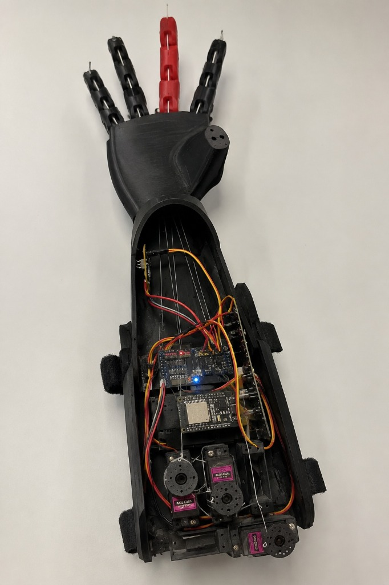
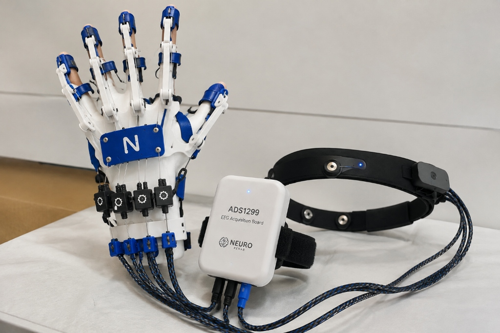

# NeuroStride — Seed Investment & Product Overview (Phase 1 & Phase 3)

> **Seeking:** ₹1 Cr Seed Round  
> **Tagline:** AI-powered neurorehabilitation — restoring movement, restoring life.  
> **Founder:** Prathmesh (LTPratham)  
> **Event:** Built for LPU Ideathon 2026 | Patent Published  

---

## Executive Summary Video & Hardware Demo

> [!TIP]
> **Working Product Video Demo**: Watch the live physical hardware prototype actuation, EMG signal bridge, and motor intent response below.

<video controls width="100%" poster="neurostride_phase1_prototype.jpg" src="neurostride_demo_video.mp4">
  Your browser does not support the video tag. You can download or play the file directly:
  <a href="neurostride_demo_video.mp4">Download / Watch Demo Video (MP4)</a>
</video>

*If your video player is not rendering above, click here to launch:*  
🎬 **[Watch Live Product Demo Video (neurostride_demo_video.mp4)](file:///d:/projects/neurostride/documentation/main-documentation/neurostride_demo_video.mp4)**

---

## 1. Problem Statement

India faces a severe, unaddressed neurorehabilitation crisis:
- **1.8 Million+** new stroke cases annually.
- **6 Million** individuals living with stroke-related disability.
- **High Prevalence** of cerebral palsy (~3 in 1,000 live births) and traumatic brain injuries (1.5–2M annual hospitalizations).
- **Core Friction**:
  - **No continuity of care**: Data is lost between sparse hospital visits.
  - **Fragmented handoffs**: Doctor to pharmacy workflows are manual and error-prone.
  - **Prohibitive cost**: Clinical-grade EMG/EEG hardware costs ₹5 Lakhs to ₹50 Lakhs, pricing out 95%+ of Indian patients.

---

## 2. The Solution — Unified AI Ecosystem & Hardware Bridge

NeuroStride unifies **Doctor**, **Patient**, and **Pharmacist** portals into one cohesive AI platform connected to affordable wearable robotics:

- **ESP32 + ADS1299 Hardware Bridge**: Real-time 24-bit low-noise EMG/EEG biosignal acquisition at a fraction of clinical costs.
- **Groq LLM Clinical Engine**: Multilingual AI rehabilitation chatbot, automated progress reporting, and drug interaction safety checks.
- **PharmaMind Integration**: Direct prescription auto-routing, stock management, OCR prescription scanner, and GST invoice generation.
- **Intent-Driven Exoskeleton**: Motor intent detection triggering physical finger flexion for paralyzed limbs.

---

## 3. Product Evolution — Phase 1 MVP vs. Phase 3 Production

| Specification | Phase 1 MVP Prototype (Live) | Phase 3 Commercial Product (Scale Target) |
|---|---|---|
| **Visual** |  |  |
| **Microcontroller / AFE** | ESP32-WROOM-32D + Single-Channel EMG | ESP32 + Custom ADS1299 8-Channel AFE Board |
| **Resolution & Sampling** | 12-bit ADC, ~100 Hz | 24-bit ADC, 250–1000 Hz Clinical Precision |
| **Exoskeleton Construction** | 3D-printed PLA frame + MG996R Servos | Ergonomic White/Blue PETG Exoskeleton Glove |
| **Electrodes & Wearability** | Wired surface EMG pads + velcro straps | Active dry EEG headband + shielded EMG cables |
| **Manufacturing Cost (COGS)** | ~₹4,500 | **₹11,200** (under ₹12,000 target limit) |
| **Retail Price Target** | N/A (Internal Test Rig) | **₹25,000** (Full Kit) / **₹16,000** (Stand-alone Board) |

---

## 4. Market Opportunity (TAM / SAM / SOM)

- **TAM (Total Addressable Market)**: **₹66,700 Cr ($8.0B)** — India's medical rehabilitation services market, projected to reach ~$12B by 2030.
- **SAM (Serviceable Addressable Market)**: **₹4,800 Cr** — Hospitals, rehab centers, and home-care patients treating stroke, cerebral palsy, and TBI in India.
- **SOM (Serviceable Obtainable Market)**: **₹12 Cr** — NeuroStride's Years 1–3 pilot target across 3 pilot hospitals, 500 patients, 50 doctors, and 20 pharmacy partners.

---

## 5. Competitive Landscape

| Competitor Group | Representative Players | Limitations vs. NeuroStride |
|---|---|---|
| **Hospital Robotic Hardware** | Genrobotics G-Gaiter, Hocoma Lokomat | ₹5–50L+ capital cost; in-clinic only; no software/AI or pharmacy layer. |
| **Home / Wearable Rehab** | BeAble Health ArmAble, Cognimate Smart Glove | Point solutions; motion sensors only; no multi-stakeholder clinical coordination. |
| **Rehab Care Delivery** | Health Care at Home (HCAH) | Human-delivered service, hard to scale digitally; no proprietary AI or robotics. |

> **NeuroStride's Edge**: The only platform unifying EMG/EEG biosignal intelligence, LLM clinical decision support, integrated pharmacy fulfillment, and intent-driven robotics — patent-protected and priced under ₹25,000 retail.

---

## 6. Go-To-Market & 6-Month Trajectory

### 6.1 GTM Phases
1. **Pilot Hospitals**: Direct outreach + free pilot deployment in 3 hospitals; clinician onboarding.
2. **Adoption Ramp**: Word-of-mouth doctor referrals; PharmaMind pharmacy stickiness.
3. **Multi-Hospital Scale**: Multi-tenant SaaS rollout, mobile app extension for home care, ABDM/HL7 FHIR integration.

### 6.2 Patient Trajectory (Months 1 to 6)
- **Month 1**: DPDPA compliance, AES-256 encryption, audit logging.
- **Month 2**: CI/CD pipeline, WCAG 2.1 AA audit, Hindi localization.
- **Month 3**: Push notifications, anomaly detection, pilot hospital outreach (Target: 25 active patients).
- **Month 4**: Onboard first pilot hospital; live patient sessions begin (Target: 90 active patients).
- **Month 5**: Expand to 2nd–3rd hospitals; doctor & pharmacy onboarding (Target: 220 active patients).
- **Month 6**: **500 active patients • 50 doctors • 20 pharmacy partners** (Target: 500 active patients).

---

## 7. The Ask — ₹1 Cr Seed Round Allocation

The **₹1 Cr Seed Round** provides an 18-month operational runway to take NeuroStride from a working MVP to 3 live pilot hospitals and 500 active patients, validating clinical outcomes and unit economics ahead of Series A.

```
+-----------------------------------------------------------------------+
|  ₹35L (35%) — Hardware Manufacturing & Clinical Pilots                 |
|  ₹25L (25%) — Product & Engineering (Full-stack, AI, Firmware)         |
|  ₹15L (15%) — Regulatory & Compliance (CDSCO SaMD, DPDPA, ISO 13485)  |
|  ₹15L (15%) — Sales & Hospital Partnerships (Clinical Ops & BD)        |
|  ₹10L (10%) — Core Team Hiring                                         |
+-----------------------------------------------------------------------+
```

---

## 8. Summary Information

- **Patent Published**: Core biosignal modulation + AI methodology.
- **Phase 1 MVP Live**: 3 role-based web portals + serial hardware bridge + working servo arm demo.
- **Deployed in Production**: Render backend + Vercel frontend.
- **Founder-Led**: Built end-to-end (backend, frontend, hardware, AI).
