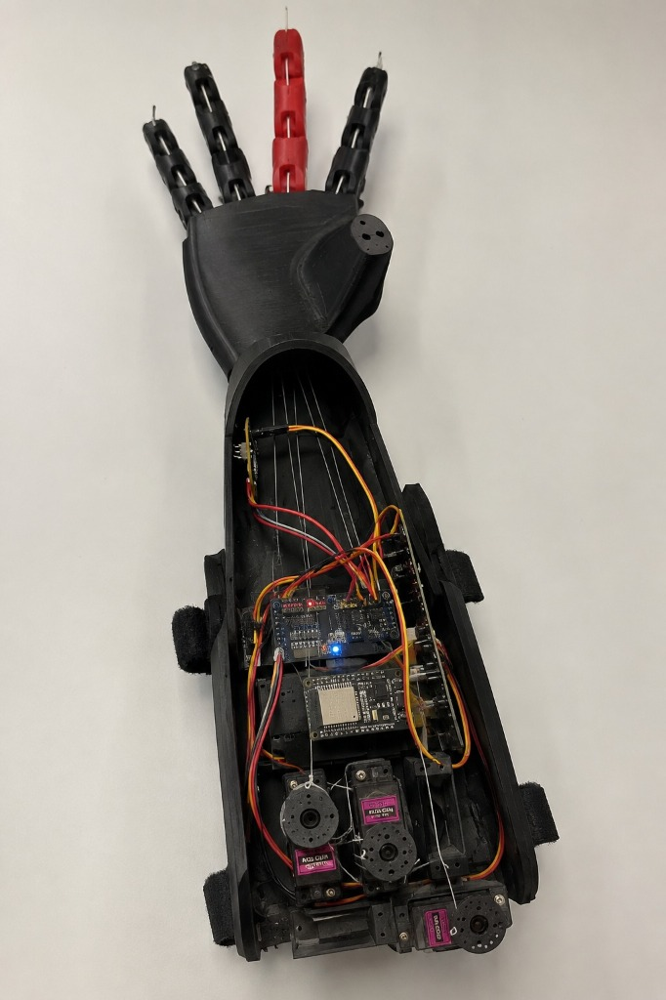
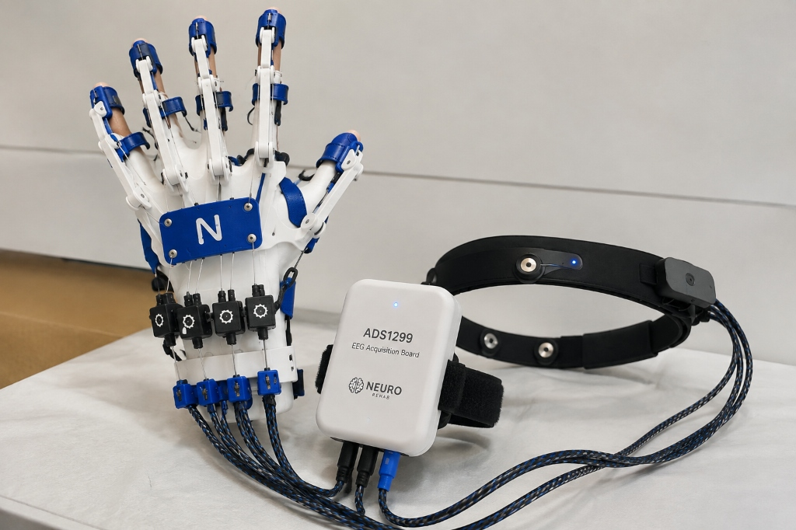

# NeuroStride — Product Requirements Document (PRD)

> **Document Version:** 1.0.0
> **Status:** Active
> **Created:** 2026-08-03
> **Last Updated:** 2026-08-03
> **Owner:** Prathmesh (LTPratham)
> **Classification:** Internal — Confidential

---

## Table of Contents

1. [Executive Summary](#1-executive-summary)
2. [Problem Statement](#2-problem-statement)
3. [Vision & Mission](#3-vision--mission)
4. [Goals & Success Metrics](#4-goals--success-metrics)
5. [Stakeholders](#5-stakeholders)
6. [User Personas](#6-user-personas)
7. [User Journey Maps](#7-user-journey-maps)
8. [System Architecture Overview](#8-system-architecture-overview)
9. [Functional Requirements](#9-functional-requirements)
10. [Non-Functional Requirements](#10-non-functional-requirements)
11. [Data Models & Schema](#11-data-models--schema)
12. [API Contract Summary](#12-api-contract-summary)
13. [Security Requirements](#13-security-requirements)
14. [Compliance & Regulatory Requirements](#14-compliance--regulatory-requirements)
15. [Accessibility Requirements](#15-accessibility-requirements)
16. [Localization & Internationalization](#16-localization--internationalization)
17. [Hardware Specifications](#17-hardware-specifications)
18. [Integration Requirements](#18-integration-requirements)
19. [Deployment & Infrastructure](#19-deployment--infrastructure)
20. [Phased Roadmap](#20-phased-roadmap)
21. [Risk Register](#21-risk-register)
22. [Open Questions & Decisions](#22-open-questions--decisions)
23. [Glossary](#23-glossary)
24. [Document Revision History](#24-document-revision-history)

---

## 1. Executive Summary

**NeuroStride** is an end-to-end, AI-powered neurorehabilitation platform designed for stroke survivors, patients with cerebral palsy, traumatic brain injuries (TBI), and other neurological conditions prevalent across India. The platform bridges the critical gap between clinical care, physical therapy, and pharmaceutical management by unifying three specialized portals — Doctor, Patient, and Pharmacist — into a single, cohesive ecosystem.

At its core, NeuroStride delivers:
- **Real-time biosignal intelligence** via EMG/EEG data streaming from the Neuphony EXG Synapse (ESP32) board, with IIR-filtered signal processing and FFT-based frequency band analysis.
- **LLM-driven clinical decision support** via the Groq API (Llama 3.3 / Mixtral models), powering a multilingual rehabilitation chatbot and AI-generated progress reports.
- **Integrated pharmacy management (PharmaMind)** with prescription auto-routing, inventory tracking, GST-compliant invoice generation, and OCR-based prescription scanning.
- **Intent-triggered robotic therapy** via servo-controlled exoskeleton arms, enabling motor retraining at the hardware level.

The platform was conceived and developed for **LPU Ideathon 2026** and is backed by a published patent covering the core biosignal + AI rehabilitation methodology.

---

## 2. Problem Statement

### 2.1 Background

Neurological disorders are among the leading causes of death and long-term disability worldwide. In India alone:

- Stroke is the **second leading cause of death**, with over **1.8 million new cases annually**.
- An estimated **6 million people** live with stroke-related disability.
- Cerebral palsy affects approximately **3 in 1,000 live births**.
- Traumatic brain injuries account for **1.5-2 million hospitalizations** per year.

### 2.2 The Gap

Despite the scale of the problem, neurorehabilitation in India is severely fragmented:

| Pain Point | Current State |
|---|---|
| **Access to specialists** | Neurologists concentrated in Tier-1 cities; rural areas severely underserved |
| **Session continuity** | No structured data captured between hospital visits; recovery is invisible between sessions |
| **Patient engagement** | Exercises are paper-prescribed; no feedback loop to motivate at-home practice |
| **Pharmacist disconnect** | Prescription handoffs are manual, error-prone, and delay medication delivery |
| **Clinical reporting** | Doctors create progress reports manually; time-consuming and inconsistent |
| **Hardware cost** | Clinical EMG/EEG systems cost Rs. 5-50 lakh; inaccessible to most patients |

### 2.3 The Opportunity

NeuroStride addresses every dimension of this gap by delivering a **full-stack neurorehabilitation platform** at a fraction of traditional hardware costs, powered by open-source AI, and accessible to both urban clinics and district hospitals.

---

## 3. Vision & Mission

### Vision
> *"Make world-class neurorehabilitation universally accessible — one recovered stride at a time."*

### Mission
To build the most complete, AI-augmented neurorehabilitation platform in India that empowers doctors to make data-driven decisions, gives patients measurable recovery milestones, and connects every stakeholder in the care continuum through a unified digital ecosystem.

### Core Principles

1. **Patient First** — Every design and feature decision must reduce friction for the patient.
2. **Evidence-Based** — Clinical claims and AI outputs must be grounded in medical literature.
3. **Accessible by Default** — Works on low-bandwidth networks, low-end devices, and for users with limited digital literacy.
4. **Open & Interoperable** — Built on open standards (HL7 FHIR-ready, REST APIs) to integrate with existing hospital systems.
5. **Privacy by Design** — Patient health data is encrypted at rest and in transit; minimum necessary data principle applied everywhere.

---

## 4. Goals & Success Metrics

### 4.1 Business Goals

| Goal | Target | Timeline |
|---|---|---|
| Platform launch (production) | Stable v1.0 deployment | Q3 2026 |
| Pilot hospital partnerships | 3 hospitals onboarded | Q4 2026 |
| Active patients on platform | 500 patients | Q1 2027 |
| Doctor adoption | 50 registered doctors | Q1 2027 |
| Pharmacist integrations | 20 pharmacy partners | Q1 2027 |

### 4.2 Product Metrics (KPIs)

| Metric | Definition | Target |
|---|---|---|
| **Session Completion Rate** | % of exercise plans completed vs. assigned | >= 70% |
| **Average Session Duration** | Mean duration per rehab session | 25-40 minutes |
| **LLM Response Latency** | P95 latency for AI chatbot response | < 3 seconds |
| **API Uptime** | Backend availability | >= 99.5% |
| **Signal Data Loss Rate** | % of WebSocket frames dropped during sensor streaming | < 0.5% |
| **Report Generation Time** | Time from click to DOCX download | < 10 seconds |
| **Prescription-to-Order Lag** | Time from doctor prescription to pharmacy order creation | < 30 seconds |
| **User Retention (30-day)** | Patients returning within 30 days | >= 60% |

### 4.3 Health Outcomes (Long-Term)

- Measurable improvement in motor function scores (Fugl-Meyer / Barthel Index) for >= 65% of active patients after 8 weeks.
- Reduction in unplanned clinical visits by >= 20% via proactive AI alerts and remote monitoring.

---

## 5. Stakeholders

| Stakeholder | Role | Interest |
|---|---|---|
| **Patients** | Primary end-users | Guided recovery, progress visibility, medication tracking |
| **Neurologists / Physiatrists (Doctors)** | Clinical operators | Patient management, exercise plans, prescriptions, AI-assisted reporting |
| **Pharmacists** | Dispensing operators | Prescription fulfilment, inventory management, invoice generation |
| **Hospital Administrators** | Decision-makers | ROI, compliance, multi-doctor management, aggregated outcomes |
| **Research Institutions** | Data consumers (future) | Anonymised population-level rehab data |
| **Regulatory Bodies** | Compliance | DPDPA, CDSCO medical device compliance, IT Act 2000 |
| **Investors / Ideathon Judges** | Evaluators | Innovation, scalability, clinical impact |
| **Patent Office (India)** | IP Governance | Protection of biosignal + AI methodology patent |

---

## 6. User Personas

### 6.1 Dr. Ananya Sharma — Neurologist

| Attribute | Details |
|---|---|
| **Age** | 38 |
| **Location** | Jalandhar, Punjab |
| **Tech Comfort** | High |
| **Device** | Desktop + iPad |
| **Goals** | Manage 30+ patients efficiently; reduce time on manual reports; spot recovery plateaus early |
| **Pain Points** | 2-3 hrs/week writing reports; no visibility into at-home exercises; prescriptions lost in paper handoffs |
| **Quote** | *"I need to know if my patient is actually doing their exercises or just telling me they are."* |

### 6.2 Ravi Kumar — Stroke Patient, Age 54

| Attribute | Details |
|---|---|
| **Age** | 54 |
| **Location** | Ludhiana, Punjab |
| **Tech Comfort** | Low-Moderate |
| **Device** | Android phone (budget) |
| **Condition** | Left hemiplegia post-ischemic stroke |
| **Goals** | Regain arm mobility; understand recovery progress; easily communicate with doctor |
| **Pain Points** | Forgets exercises; can't afford frequent hospital visits; confused by English medical terms |
| **Quote** | *"Main sirf yeh jaanna chahta hoon ki mera hath theek ho raha hai ya nahi."* |

### 6.3 Meena Pillai — Hospital Pharmacist

| Attribute | Details |
|---|---|
| **Age** | 45 |
| **Location** | Hospital pharmacy, Jalandhar |
| **Tech Comfort** | Moderate |
| **Device** | Desktop |
| **Goals** | Process prescriptions accurately; track inventory; generate compliant invoices |
| **Pain Points** | Deciphering handwritten prescriptions; manually tracking low stock; GST calculation errors |
| **Quote** | *"When the prescription comes automatically with the right drug name and dosage, I can dispense in minutes."* |

---

## 7. User Journey Maps

### 7.1 Doctor — Creating an Exercise Plan

```
Login -> Select Patient -> Review Profile & History
  -> View Latest Session Metrics (EMG/progress charts)
    -> Create Exercise Plan (title, exercises, sets, reps, duration)
      -> AI Auto-suggests based on diagnosis
        -> Doctor reviews & approves
          -> Plan auto-assigned to Patient Portal
```

### 7.2 Patient — Completing a Rehab Session

```
Login -> Dashboard (today's plan visible)
  -> Connect Hardware (or Simulation Mode)
    -> Start Session -> Real-time EMG Waveform Stream
      -> Follow guided exercises -> Intent detection triggers servo arm
        -> Complete session -> Metrics auto-logged
          -> Session summary shown -> Progress chart updated
            -> AI chatbot available for post-session guidance
```

### 7.3 Pharmacist — Processing a Prescription

```
Doctor writes prescription -> Auto-routed to PharmaMind
  -> Pharmacist notified -> Review order in dashboard
    -> Check inventory -> Mark items dispensed
      -> Generate GST invoice (PDF/DOCX)
        -> Update order status to dispensed
          -> Patient prescription history updated automatically
```

---

## 8. System Architecture Overview

```
+----------------------------------------------------------------------+
|                          NeuroStride Platform                        |
|                                                                      |
|  +---------------------+   HTTPS   +------------------------------+ |
|  |   Next.js 14        |<--------->|   FastAPI Core               | |
|  |   Frontend (3000)   |           |   Backend (8000)             | |
|  |                     |           |                              | |
|  | Doctor Portal       |           | Auth (JWT + bcrypt)          | |
|  | Patient Portal      |           | Rate Limiting (SlowAPI)      | |
|  | PharmaMind          |           | Pydantic Validation          | |
|  +---------------------+           |                              | |
|                                    | SQLite (Dev) / PgSQL (Prod)  | |
|                                    +------------------------------+ |
|                                                                      |
|  External AI            Hardware Layer (Optional)                   |
|  Groq LLM               Neuphony EXG Synapse (ESP32)               |
|  Langfuse Observ.         -> neuphony_bridge.py                     |
|                             -> IIR Filter + FFT                      |
|                             -> WebSocket :8765 -> Frontend          |
|                             -> Servo Controller -> Arm              |
|                                                                      |
|  Deploy: Backend on Render | Frontend on Vercel                     |
+----------------------------------------------------------------------+
```

### 8.1 Technology Stack

| Layer | Technology | Version | Rationale |
|---|---|---|---|
| **Backend API** | FastAPI | >= 0.111 | Async-first, OpenAPI auto-docs, high performance |
| **Backend Language** | Python | 3.11+ | Mature ML ecosystem |
| **ORM** | SQLAlchemy | >= 2.0 | Async support, DB portability |
| **Database (Dev)** | SQLite | — | Zero-config local development |
| **Database (Prod)** | PostgreSQL | >= 15 | ACID compliance, production-grade |
| **Auth** | python-jose + passlib | — | JWT tokens, bcrypt password hashing |
| **Rate Limiting** | SlowAPI | >= 0.1.9 | FastAPI-native, Redis-compatible |
| **AI / LLM** | Groq (Llama 3.3 / Mixtral) | — | Ultra-low latency inference |
| **LLM Observability** | Langfuse | >= 2.7 | Token tracking, prompt tracing |
| **Frontend** | Next.js | 14 | SSR, file-based routing, React 18 |
| **Charting** | Recharts | — | Declarative React charts |
| **HTTP Client** | Axios | — | Interceptors, request/response transforms |
| **Document Gen** | python-docx | >= 1.1.0 | DOCX reports + pharmacy invoices |
| **OCR** | pytesseract + Pillow | — | Handwritten prescription scanning |
| **Hardware Serial** | PySerial | — | USB communication with ESP32 |
| **WebSocket** | websockets (Python) | — | Real-time sensor data bridge |
| **Validation** | Pydantic | >= 2.7 | Schema validation, serialisation |
| **Backend Deploy** | Render | — | Auto-deploy from GitHub, managed TLS |
| **Frontend Deploy** | Vercel | — | Edge CDN, auto-preview deployments |

---

## 9. Functional Requirements

> Priority: P0=Must Have | P1=Should Have | P2=Nice to Have | P3=Future

### 9.1 Authentication & Authorization

| ID | Requirement | Priority |
|---|---|---|
| AUTH-01 | System supports three user roles: doctor, patient, pharmacist | P0 |
| AUTH-02 | Users authenticate via email + password; system issues signed JWT (HS256) | P0 |
| AUTH-03 | Passwords hashed using bcrypt (work factor >= 12); plaintext never persisted | P0 |
| AUTH-04 | All protected endpoints validate JWT Authorization: Bearer header | P0 |
| AUTH-05 | RBAC enforced at API layer; cross-role access returns HTTP 403 | P0 |
| AUTH-06 | JWT secret key loaded from environment variable SECRET_KEY; never hardcoded | P0 |
| AUTH-07 | Token expiry defaults to 8 hours; configurable via ACCESS_TOKEN_EXPIRE_MINUTES | P1 |
| AUTH-08 | Rate limiting: max 10 failed login attempts per IP per 15 minutes; returns HTTP 429 | P1 |
| AUTH-09 | /api/auth/me returns current user role, email, full name | P0 |
| AUTH-10 | Registration validates unique email, valid format, password min length 8 | P0 |

### 9.2 Doctor Portal

#### Patient Management

| ID | Requirement | Priority |
|---|---|---|
| DOC-PM-01 | Doctor views paginated list of assigned patients: name, diagnosis, last session date, plan status | P0 |
| DOC-PM-02 | Doctor views full patient profile: demographics, diagnosis, affected side, allergies, current meds | P0 |
| DOC-PM-03 | Doctor updates patient profile fields | P1 |
| DOC-PM-04 | Doctor searches/filters patients by name, diagnosis, last session date | P1 |
| DOC-PM-05 | Doctor assigns themselves to an unassigned patient | P1 |

#### Exercise Plan Management

| ID | Requirement | Priority |
|---|---|---|
| DOC-EP-01 | Doctor creates exercise plan: title, description, exercises (name, sets, reps, duration), frequency/week, duration in weeks | P0 |
| DOC-EP-02 | Exercise plan immediately visible in patient portal upon creation | P0 |
| DOC-EP-03 | Doctor can view, edit, or deactivate existing exercise plans | P1 |
| DOC-EP-04 | System flags when patient has no active exercise plan | P1 |
| DOC-EP-05 | AI-assisted exercise plan generation via Groq LLM based on patient diagnosis | P1 |
| DOC-EP-06 | AI-generated plans marked ai_generated:true; require explicit doctor approval before activation | P1 |

#### Prescription Management

| ID | Requirement | Priority |
|---|---|---|
| DOC-RX-01 | Doctor creates digital prescription: medications (name, dosage, frequency, duration), clinical notes | P0 |
| DOC-RX-02 | Prescription auto-routed to pharmacy as PharmacyOrder (status: pending) upon creation | P0 |
| DOC-RX-03 | Doctor views all issued prescriptions with current status | P1 |
| DOC-RX-04 | AI-based drug interaction check on prescription creation (non-blocking warning) | P1 |
| DOC-RX-05 | Doctor can cancel a prescription not yet dispensed | P1 |

#### Reporting & Progress Review

| ID | Requirement | Priority |
|---|---|---|
| DOC-REP-01 | Doctor triggers AI-generated progress report for any patient over selectable date range | P0 |
| DOC-REP-02 | AI report includes: summary narrative, strengths, improvement areas, clinical recommendations | P0 |
| DOC-REP-03 | Doctor views, annotates, and approves AI report with single click | P0 |
| DOC-REP-04 | Doctor downloads approved report as formatted .docx with demographics, charts, AI summary, notes | P0 |
| DOC-REP-05 | Doctor dashboard: total sessions this week, avg form score, flagged patients (2+ missed sessions) | P1 |

### 9.3 Patient Portal

#### Dashboard

| ID | Requirement | Priority |
|---|---|---|
| PAT-DASH-01 | Dashboard displays: today's exercises, last session summary, streak count, assigned doctor | P0 |
| PAT-DASH-02 | Recharts progress chart: 30-day trends for total reps, avg form score, EMG peak/avg | P0 |
| PAT-DASH-03 | Patient views complete session history with date, duration, key metrics | P1 |

#### Rehab Session

| ID | Requirement | Priority |
|---|---|---|
| PAT-SES-01 | Patient starts a new rehab session from dashboard | P0 |
| PAT-SES-02 | Session displays exercise list from active plan with set/rep counters | P0 |
| PAT-SES-03 | Patient marks individual exercises as complete during session | P0 |
| PAT-SES-04 | Patient ends session; system records duration, exercises completed, total reps, avg form score | P0 |
| PAT-SES-05 | Session summary shown immediately after session ends | P0 |
| PAT-SES-06 | Session data persisted and immediately visible to assigned doctor | P0 |

#### Live Sensor Feed

| ID | Requirement | Priority |
|---|---|---|
| PAT-SENS-01 | Patient connects to live sensor WebSocket stream (port 8765) from /patient/sensor page | P0 |
| PAT-SENS-02 | EMG waveform visualised in real-time as scrolling line chart at ~20 fps | P0 |
| PAT-SENS-03 | Displays: raw EMG value, RMS (rolling 50-sample window), signal quality, intent detection status | P0 |
| PAT-SENS-04 | Intent detection triggers visual indicator and servo command when EMG RMS exceeds threshold | P0 |
| PAT-SENS-05 | FFT band power displayed: Delta, Theta, Alpha, Beta, Gamma percentage bars | P1 |
| PAT-SENS-06 | Platform functions in Simulation Mode (synthetic EMG) when no hardware connected | P0 |
| PAT-SENS-07 | Session-level EMG metrics (peak, avg RMS, intent count) auto-logged when session active | P1 |

#### AI Rehabilitation Chatbot

| ID | Requirement | Priority |
|---|---|---|
| PAT-CHAT-01 | Patient has multilingual AI chatbot (English + Hindi) powered by Groq LLM | P0 |
| PAT-CHAT-02 | Chatbot pre-prompted with: patient diagnosis, affected side, current exercise plan | P0 |
| PAT-CHAT-03 | Language auto-detected from patient input; responds in same language | P1 |
| PAT-CHAT-04 | Conversation history persists within session; cleared on session end | P1 |
| PAT-CHAT-05 | Chatbot explicitly states it is not a substitute for professional medical advice | P0 |
| PAT-CHAT-06 | All LLM calls traced in Langfuse for cost tracking and quality monitoring | P1 |

#### Prescription & Medication History

| ID | Requirement | Priority |
|---|---|---|
| PAT-MED-01 | Patient views all prescriptions: medication list, date, pharmacy order status | P0 |
| PAT-MED-02 | Patient notified when prescription dispensed by pharmacy | P2 |

### 9.4 PharmaMind — Pharmacist Portal

#### Order Management

| ID | Requirement | Priority |
|---|---|---|
| PHARM-ORD-01 | Dashboard shows all pharmacy orders: patient name, medications, date, status | P0 |
| PHARM-ORD-02 | Filter orders by status: pending, processing, dispensed, cancelled | P0 |
| PHARM-ORD-03 | Update order status: pending -> processing -> dispensed | P0 |
| PHARM-ORD-04 | Status changes reflected in real-time on Doctor and Patient portals | P1 |
| PHARM-ORD-05 | Pharmacist adds internal notes to any order | P1 |

#### Inventory Management

| ID | Requirement | Priority |
|---|---|---|
| PHARM-INV-01 | View full medicine inventory: name, generic name, category, strength, stock, reorder level, price, expiry | P0 |
| PHARM-INV-02 | System highlights medicines below reorder threshold with visual low-stock alert | P0 |
| PHARM-INV-03 | Update stock quantity for any medicine | P0 |
| PHARM-INV-04 | Add new medicines to inventory | P1 |
| PHARM-INV-05 | Flag medicines with expiry dates within next 30 days | P1 |
| PHARM-INV-06 | Search inventory by medicine name or generic name | P1 |

#### Invoice Generation

| ID | Requirement | Priority |
|---|---|---|
| PHARM-BILL-01 | Generate GST-compliant itemised invoice for any dispensed order | P0 |
| PHARM-BILL-02 | Invoice includes: patient name, doctor name, itemised medications with price, GST, total, pharmacy stamp area | P0 |
| PHARM-BILL-03 | Invoice downloadable as .docx and .pdf | P0 |
| PHARM-BILL-04 | GST calculation follows Indian pharmaceutical slabs (5%, 12%, 18%) | P1 |

#### OCR Prescription Scanner

| ID | Requirement | Priority |
|---|---|---|
| PHARM-OCR-01 | Upload handwritten prescription image; pytesseract extracts text | P1 |
| PHARM-OCR-02 | Extracted text displayed for manual correction before creating pharmacy order | P1 |
| PHARM-OCR-03 | OCR raw text stored against pharmacy order for audit purposes | P1 |

### 9.5 Hardware Integration Layer

| ID | Requirement | Priority |
|---|---|---|
| HW-01 | neuphony_bridge.py connects to Neuphony EXG Synapse ESP32 via USB serial at 115200 baud | P0 |
| HW-02 | Bridge reads raw ADC samples and applies IIR bandpass filters mirroring Synapse.h coefficients | P0 |
| HW-03 | Filtered signal broadcast over WebSocket (port 8765) at approximately 20 fps | P0 |
| HW-04 | Intent detection: when rolling RMS exceeds configurable threshold, emits INTENT_DETECTED event | P0 |
| HW-05 | On INTENT_DETECTED, bridge sends servo pulse command to arm controller if present | P1 |
| HW-06 | FFT computed on rolling window; Delta/Theta/Alpha/Beta/Gamma band powers transmitted | P1 |
| HW-07 | Simulation Mode: --simulate flag generates synthetic EMG signal; no hardware required | P0 |
| HW-08 | Port auto-detection: bridge scans available COM/tty ports if no --port argument given | P1 |
| HW-09 | Bridge handles serial disconnection gracefully with exponential backoff reconnection | P1 |
| HW-10 | Hardware communication runs in separate process/thread; does not block API server | P0 |

### 9.6 AI Intelligence Layer

| ID | Requirement | Priority |
|---|---|---|
| AI-01 | Groq API key loaded from GROQ_API_KEY env var; platform degrades gracefully if missing | P0 |
| AI-02 | LLM model configurable (default: llama-3.3-70b-versatile); fallback to mixtral-8x7b-32768 on rate limit | P1 |
| AI-03 | AI chatbot system prompt includes: patient name, diagnosis, affected side, exercise plan, language | P0 |
| AI-04 | Progress report prompt includes: patient profile, date range, all session metrics, prior summaries | P0 |
| AI-05 | Drug interaction check: LLM evaluates potential interactions between all listed medications | P1 |
| AI-06 | All LLM calls wrapped with Langfuse tracing: session ID, user ID, prompt/completion tokens, latency | P1 |
| AI-07 | AI outputs labelled as AI-generated throughout UI; Doctor must approve any AI clinical output | P0 |
| AI-08 | LLM calls have configurable timeout (default 30s); graceful error message on timeout | P1 |

### 9.7 Reporting & Analytics

| ID | Requirement | Priority |
|---|---|---|
| REP-01 | Session history persisted with full metric set: duration, reps, form score, EMG peak, avg RMS, intent count, signal quality | P0 |
| REP-02 | Patient progress charts display 30-day rolling trend for reps, form score, session count | P0 |
| REP-03 | AI progress report covers configurable date range; default is last 4 weeks | P0 |
| REP-04 | .docx report template: cover page, demographics table, session trends, AI narrative, doctor notes, signature block | P1 |
| REP-05 | Langfuse dashboard for admin: LLM cost per user, error rates, latency trends | P2 |
| REP-06 | Population-level de-identified analytics dashboard for clinical research | P3 |

---

## 10. Non-Functional Requirements

### 10.1 Performance

| Metric | Requirement |
|---|---|
| API response time (P95) | < 500ms for all CRUD endpoints |
| AI chatbot response (P95) | < 3 seconds end-to-end including Groq network latency |
| WebSocket frame rate | >= 15 fps (target 20 fps) for sensor data |
| Frontend First Contentful Paint | < 2 seconds on 4G connection |
| Frontend Time to Interactive | < 4 seconds on 4G connection |
| Report DOCX generation | < 10 seconds |
| Concurrent users (initial) | >= 100 simultaneous users without degradation |

### 10.2 Scalability

- Backend is stateless and horizontally scalable; session state managed via JWT.
- Database connection pooling via SQLAlchemy; pool size configurable.
- Rate limiting backed by in-memory store (dev) or Redis (production).
- WebSocket sensor bridge is patient-specific; each patient session gets an isolated stream.

### 10.3 Reliability

- Backend deployed on Render with auto-restart on crash.
- Database: SQLite in development; PostgreSQL in production.
- All database migrations use SQLAlchemy create_all() on startup (idempotent).
- Seed scripts are isolated and safe to re-run.
- Hardware bridge reconnects automatically on serial disconnection.

### 10.4 Maintainability

- Backend structured by concern: main.py, models/, routers/, agents/, core/.
- All route handlers use Pydantic models for request/response validation.
- Environment configuration centralised in .env files; .env.example maintained.
- API auto-documented via FastAPI's OpenAPI (Swagger UI at /docs, ReDoc at /redoc).
- All dependencies pinned with minimum version bounds in requirements.txt.

### 10.5 Observability

- Langfuse traces all LLM calls with token counts, latency, and session metadata.
- Application logs follow structured JSON format in production.
- Health check endpoint at GET /health returns {"status": "ok", "version": "x.y.z"}.
- Render deployment includes health check ping every 5 minutes.

---

## 11. Data Models & Schema

### 11.1 Entity Relationship Summary

```
User (1) ------------ (1) PatientProfile
User (1) ------------ (1) DoctorProfile
PatientProfile (1) -- (N) RehabSession
PatientProfile (1) -- (N) ExercisePlan (via doctor)
PatientProfile (1) -- (N) Prescription
PatientProfile (1) -- (N) ProgressReport
Prescription   (1) -- (1) PharmacyOrder
MedicineInventory        (standalone)
```

### 11.2 User

| Field | Type | Constraints | Description |
|---|---|---|---|
| id | UUID string | PK | Auto-generated UUID |
| email | string(255) | UNIQUE, NOT NULL, indexed | Login identifier |
| full_name | string(255) | NOT NULL | Display name |
| hashed_password | string(255) | NOT NULL | bcrypt hash |
| role | enum | NOT NULL | patient / doctor / pharmacist |
| phone | string(20) | nullable | Contact number |
| language | string(10) | default en | Preferred UI / chatbot language |
| is_active | boolean | default true | Soft-disable accounts |
| created_at | datetime | server default | Audit timestamp |
| updated_at | datetime | auto-update | Audit timestamp |

### 11.3 PatientProfile

| Field | Type | Constraints | Description |
|---|---|---|---|
| id | UUID | PK | — |
| user_id | UUID FK | UNIQUE, NOT NULL | Links to User |
| date_of_birth | string(20) | nullable | ISO date string |
| gender | string(20) | nullable | — |
| blood_group | string(5) | nullable | e.g. A+ |
| weight_kg | float | nullable | — |
| height_cm | float | nullable | — |
| diagnosis | text | nullable | Clinical diagnosis narrative |
| affected_side | string(10) | nullable | left / right / bilateral |
| paralysis_level | string(50) | nullable | Severity descriptor |
| allergies | JSON array | default [] | Drug/material allergies |
| current_meds | JSON array | default [] | Current medication list |
| emergency_contact | string(255) | nullable | Name + phone |
| assigned_doctor_id | UUID FK | nullable | References User (doctor) |

### 11.4 RehabSession

| Field | Type | Constraints | Description |
|---|---|---|---|
| id | UUID | PK | — |
| patient_id | UUID FK | NOT NULL | PatientProfile reference |
| exercise_plan_id | UUID FK | nullable | ExercisePlan reference |
| started_at | datetime | server default | Session start time |
| ended_at | datetime | nullable | Session end time |
| duration_seconds | integer | default 0 | Elapsed time |
| exercises_completed | JSON array | default [] | Completed exercise IDs |
| total_reps | integer | default 0 | Aggregate rep count |
| avg_form_score | float | default 0.0 | 0.0-1.0 quality score |
| emg_peak | float | default 0.0 | Peak EMG ADC value in session |
| emg_avg_rms | float | default 0.0 | Average RMS across session |
| intent_count | integer | default 0 | Number of intent detections |
| signal_quality | float | default 0.0 | % frames with clean signal |
| notes | text | nullable | Free-text notes |
| session_mode | string(20) | default live | live / simulate |

---

## 12. API Contract Summary

### Authentication

| Method | Endpoint | Auth | Description |
|---|---|---|---|
| POST | /api/auth/register | None | Register new user |
| POST | /api/auth/login | None | Login, returns JWT |
| GET | /api/auth/me | Bearer JWT | Current user info |

### Patient Management

| Method | Endpoint | Auth | Description |
|---|---|---|---|
| GET | /api/patients | Doctor / Pharmacist | List all patients |
| GET | /api/patients/{id} | Doctor / Patient (own) | Get patient profile |
| PUT | /api/patients/{id} | Doctor | Update patient profile |

### Sessions

| Method | Endpoint | Auth | Description |
|---|---|---|---|
| POST | /api/sessions | Patient | Start a rehab session |
| PUT | /api/sessions/{id}/end | Patient | End session, log metrics |
| GET | /api/sessions | Doctor / Patient | List sessions |

### Exercise Plans

| Method | Endpoint | Auth | Description |
|---|---|---|---|
| POST | /api/exercise-plans | Doctor | Create plan |
| GET | /api/exercise-plans | Doctor / Patient | List plans |
| PUT | /api/exercise-plans/{id} | Doctor | Update plan |
| DELETE | /api/exercise-plans/{id} | Doctor | Deactivate plan |

### Prescriptions

| Method | Endpoint | Auth | Description |
|---|---|---|---|
| POST | /api/prescriptions | Doctor | Create prescription + auto-route to pharmacy |
| GET | /api/prescriptions | All roles (filtered) | List prescriptions |

### Pharmacy

| Method | Endpoint | Auth | Description |
|---|---|---|---|
| GET | /api/pharmacy/orders | Pharmacist | List all pharmacy orders |
| PUT | /api/pharmacy/orders/{id} | Pharmacist | Update order status |
| GET | /api/pharmacy/inventory | Pharmacist | Get medicine inventory |
| PUT | /api/pharmacy/inventory/{id} | Pharmacist | Update stock |
| GET | /api/pharmacy/orders/{id}/invoice | Pharmacist | Download GST invoice |

### Reports & AI

| Method | Endpoint | Auth | Description |
|---|---|---|---|
| POST | /api/reports/generate/{patient_id} | Doctor | Trigger AI report generation |
| GET | /api/reports/patient/{patient_id} | Doctor / Patient | List patient reports |
| PUT | /api/reports/{id}/approve | Doctor | Approve and annotate report |
| GET | /api/reports/{id}/download | Doctor | Download report as DOCX |

### WebSocket & System

| Protocol | Endpoint | Description |
|---|---|---|
| WS | /ws/sensor/{patient_id} | Live sensor data stream from hardware bridge |
| GET | /health | Platform health check |
| GET | /docs | Swagger UI |

---

## 13. Security Requirements

| ID | Requirement |
|---|---|
| SEC-01 | JWT signed with HS256 using >= 256-bit secret key from environment variable |
| SEC-02 | Token expiry enforced server-side; expired tokens return HTTP 401 |
| SEC-03 | Passwords hashed with bcrypt, work factor >= 12 |
| SEC-04 | All API inputs validated via Pydantic; no raw SQL string construction |
| SEC-05 | SQLAlchemy ORM used exclusively; parameterised queries prevent SQL injection |
| SEC-06 | File uploads (OCR) restricted to image MIME types; max file size 5MB |
| SEC-07 | All production traffic served over HTTPS (TLS 1.2+); managed by Render/Vercel |
| SEC-08 | CORS policy: only allow origins from Vercel frontend domain + localhost in dev |
| SEC-09 | Database credentials loaded from environment; never committed to version control |
| SEC-10 | Sensitive API keys (GROQ, Langfuse) only accessed server-side; never exposed to frontend |
| SEC-11 | Patient health data access scoped by role: patients only access their own records |
| SEC-12 | Login endpoint rate limited: 10 attempts / IP / 15 minutes; returns HTTP 429 |
| SEC-13 | Vulnerability disclosure via private email only; response SLA 72 hours |

---

## 14. Compliance & Regulatory Requirements

| Regulation | Applicability | Current Status | Target |
|---|---|---|---|
| DPDPA 2023 | All patient PII and health data | Partial - not encrypted at rest | AES-256 at rest; audit logs; retention policy |
| IT Act 2000 | Electronic health records | Compliant (basic) | Maintain |
| CDSCO SaMD | EMG/EEG processing + AI clinical recommendations | Not yet assessed | Pre-certification review before clinical deployment |
| ABDM | Health ID linkage | Roadmap (P3) | ABHA ID integration |
| HL7 FHIR R4 | Health data interoperability | Roadmap (P3) | FHIR-compliant data export |
| GST Act (India) | Pharmacy invoicing | Compliant (5%/12%/18% slabs) | Maintain |

NOTE: Before deploying NeuroStride in a clinical setting with real patients,
a regulatory review under CDSCO SaMD guidelines is required.
Current version is appropriate for research, pilot, and demonstration purposes only.

---

## 15. Accessibility Requirements

| ID | Requirement | Standard | Priority |
|---|---|---|---|
| ACC-01 | All interactive elements have visible focus indicators | WCAG 2.1 A | P1 |
| ACC-02 | Text contrast ratio >= 4.5:1 normal text; >= 3:1 large text | WCAG 2.1 AA | P1 |
| ACC-03 | All form fields have associated label elements | WCAG 2.1 A | P0 |
| ACC-04 | Images and icons have descriptive alt text | WCAG 2.1 A | P1 |
| ACC-05 | Site navigable by keyboard alone | WCAG 2.1 A | P2 |
| ACC-06 | Screen reader compatibility for patient portal primary flows | WCAG 2.1 AA | P2 |
| ACC-07 | Font size minimum 14px; scalable to 200% browser zoom without horizontal scroll | WCAG 2.1 AA | P1 |

---

## 16. Localization & Internationalization

| ID | Requirement | Priority |
|---|---|---|
| L10N-01 | AI chatbot supports English and Hindi; language auto-detected from patient input | P0 |
| L10N-02 | Patient language preference stored in User.language; used to prime chatbot system prompt | P1 |
| L10N-03 | UI text in English for v1; Hindi UI localisation targeted for v2 | P2 |
| L10N-04 | Tamil, Telugu, Bengali, Marathi chatbot support | P3 |
| L10N-05 | Currency and date formats follow Indian locale (INR, DD/MM/YYYY) | P1 |

---

## 17. Hardware Specifications

### 17.1 Visual Hardware Comparison & Working Demo

| Phase 1 MVP Prototype (Live) | Phase 3 Commercial Hardware (Scale Target) |
|---|---|
|  |  |
| **BOM Cost:** ~₹4,500 | **BOM Cost:** ₹11,200 |
| **Description:** 3D-printed arm, MG996R servo, ESP32 board | **Description:** Industrial white/blue glove, ADS1299 board |

> 🎬 **Working Product Video Demo**: [Watch Live Hardware Actuation Demo Video (neurostride_demo_video.mp4)](neurostride_demo_video.mp4)

### 17.2 ADS1299 8-Channel ESP Kit / Neuphony EXG Synapse

| Spec | Value |
|---|---|
| Microcontroller | ESP32 (dual-core 240 MHz) |
| EXG Channels | 1-8 (configurable) |
| Sampling Rate | <= 500 Hz |
| Input Impedance | > 100 MOhm |
| ADC Resolution | 24-bit (ADS1299 AFE) |
| Interface | USB Serial (115200 baud) / WSS Bridge |
| Firmware | Arduino .ino sketch from Neuphony EXG Synapse repo |

### 17.3 Signal Processing Pipeline

```
ADC Samples (raw)
  -> IIR Bandpass Filter (0.5-100 Hz, mirroring Synapse.h coefficients)
  -> Notch Filter (50 Hz power line noise removal)
  -> RMS Calculation (rolling 50-sample window)
  -> Intent Threshold Comparison
  -> FFT (256-point, Hanning window)
  -> Band Power Computation (Delta/Theta/Alpha/Beta/Gamma)
  -> WebSocket Broadcast (JSON payload @ ~20 fps)
```

### 17.4 Servo Arm Controller

| Spec | Value |
|---|---|
| Controller | Secondary COM port / PCA9685 PWM Controller |
| Protocol | Serial PWM commands |
| Trigger | INTENT_DETECTED event from bridge |
| Action | Gripping motion (individual finger 0-180 degrees) |

### 17.5 Bridge Host Requirements

| Requirement | Minimum |
|---|---|
| OS | Windows 10 / Ubuntu 20.04 / macOS 12 |
| Python | 3.11+ |
| RAM | 2 GB |
| COM Port | USB Serial driver (CP210x or CH340) |

---

## 18. Integration Requirements

| Integration | Purpose | Type | Priority |
|---|---|---|---|
| Groq API | LLM inference (chatbot + report + drug check) | REST HTTPS | P0 |
| Langfuse | LLM observability, cost tracking, prompt tracing | REST HTTPS | P1 |
| Neuphony EXG | Biosignal acquisition | USB Serial + WebSocket | P0 |
| pytesseract | OCR for handwritten prescriptions | Local binary | P1 |
| Render | Backend hosting + CI/CD | PaaS | P0 |
| Vercel | Frontend hosting + CDN | PaaS | P0 |
| ABDM | Health ID linkage | REST API | P3 |
| HL7 FHIR | Health data export | FHIR R4 REST | P3 |
| Twilio / Firebase FCM | Push notifications | REST | P2 |
| Razorpay | Payment processing (SaaS billing) | REST | P3 |

---

## 19. Deployment & Infrastructure

### 19.1 Environments

| Environment | Backend URL | Frontend URL | Database |
|---|---|---|---|
| Development | http://localhost:8000 | http://localhost:3000 | SQLite |
| Staging | https://neurostride-staging.onrender.com | https://neurostride-staging.vercel.app | PostgreSQL |
| Production | https://neurostride.onrender.com | https://neurostride.vercel.app | PostgreSQL |

### 19.2 Environment Variables

| Variable | Description | Required |
|---|---|---|
| SECRET_KEY | JWT signing secret (>= 256-bit random string) | Yes |
| GROQ_API_KEY | Groq API key for LLM inference | Yes |
| LANGFUSE_PUBLIC_KEY | Langfuse public key | Optional |
| LANGFUSE_SECRET_KEY | Langfuse secret key | Optional |
| DATABASE_URL | PostgreSQL connection string | Production only |
| ACCESS_TOKEN_EXPIRE_MINUTES | JWT token expiry (default: 480) | Optional |
| ALLOWED_ORIGINS | Comma-separated CORS origins | Yes (production) |
| ENVIRONMENT | development / staging / production | Yes |

### 19.3 CI/CD Pipeline Target (Phase 2)

```
GitHub Push -> GitHub Actions
  +-- Lint (ruff / eslint)
  +-- Unit Tests (pytest / jest)
  +-- Security Scan (bandit / npm audit)
  +-- Deploy
        +-- Backend -> Render (auto)
        +-- Frontend -> Vercel (auto)
```

### 19.4 Backup & Recovery

| Data | Backup Strategy | RPO | RTO |
|---|---|---|---|
| PostgreSQL (prod) | Render managed daily snapshots | 24 hours | < 2 hours |
| DOCX reports | Migrate to S3/GCS (P1 task) | P1 task | P1 task |
| Seed data | Version-controlled seed scripts | N/A | < 30 minutes |

---

## 20. Phased Roadmap

### Phase 1 - MVP (Complete)

- [x] Role-based authentication (Doctor / Patient / Pharmacist)
- [x] Doctor portal: patient management, exercise plans, prescriptions, progress reports
- [x] Patient portal: dashboard, session tracking, AI chatbot, EMG sensor feed
- [x] PharmaMind: order management, inventory, invoice generation, OCR scanner
- [x] Neuphony EXG hardware bridge (real + simulation mode)
- [x] Groq LLM integration with Langfuse observability
- [x] Render + Vercel deployment
- [x] MIT License + Published Patent

### Phase 2 - Clinical Hardening (Q3-Q4 2026)

- [ ] DPDPA compliance: AES-256 encryption at rest for PHI
- [ ] Audit logging: all PHI access events logged immutably
- [ ] DOCX/PDF report storage migrated to S3/GCS
- [ ] CI/CD pipeline (GitHub Actions)
- [ ] WCAG 2.1 AA accessibility audit + fixes
- [ ] Hindi UI localisation
- [ ] Real-time push notifications (prescription status, session reminders)
- [ ] Adaptive exercise difficulty (LLM-driven plan adjustment based on session trends)
- [ ] Anomaly detection: alert doctor on significant EMG/EEG deviation from baseline

### Phase 3 - Mobile & Scale (Q1-Q2 2027)

- [ ] React Native mobile app (iOS + Android) for patients
- [ ] PWA offline mode
- [ ] Multi-channel EEG support (8-channel EXG board)
- [ ] Wireless ESP32 streaming (Wi-Fi / BLE)
- [ ] Kubernetes Helm chart for multi-hospital deployment
- [ ] Multi-tenant SaaS architecture (isolated data namespaces per hospital)
- [ ] Predictive recovery timeline (ML model on session data)

### Phase 4 - Ecosystem Integration (Q3 2027+)

- [ ] ABDM (Ayushman Bharat Digital Mission) health ID linkage
- [ ] HL7 FHIR R4 data export
- [ ] Telemedicine module (in-platform video consultation)
- [ ] Clinical trial dashboard (de-identified population analytics)
- [ ] 3D-printed exoskeleton with individual finger servo control
- [ ] ECG monitoring (HRV tracking during sessions)
- [ ] Computer vision (MediaPipe pose estimation) for form scoring
- [ ] Voice-controlled interface for patients with limited motor function
- [ ] Tamil, Telugu, Bengali, Marathi chatbot localisation

---

## 21. Risk Register

| ID | Risk | Probability | Impact | Severity | Mitigation |
|---|---|---|---|---|---|
| RISK-01 | Groq API outage during live session | Medium | High | Critical | Fallback model (Mixtral); graceful degradation |
| RISK-02 | Hardware unavailable at demo | Medium | High | Critical | Simulation mode always available |
| RISK-03 | PostgreSQL production DB corruption | Low | High | High | Daily Render backups; seed scripts |
| RISK-04 | JWT secret key exposure in repo | Low | Critical | Critical | Gitignore .env; rotate key immediately if exposed |
| RISK-05 | DPDPA non-compliance for clinical deployment | High | High | Critical | Explicit Phase 2 compliance work; no clinical deployment until complete |
| RISK-06 | pytesseract OCR accuracy on handwritten prescriptions | High | Medium | High | Manual correction step before order creation |
| RISK-07 | Render free-tier cold starts | High | Medium | High | Upgrade to paid Render tier for production |
| RISK-08 | WebSocket connection drops during sensor streaming | Medium | Medium | Medium | Auto-reconnect logic; frame-loss counter shown to user |
| RISK-09 | LLM hallucinating clinical recommendations | Medium | Critical | Critical | All AI outputs require doctor approval; explicit disclaimer |
| RISK-10 | Scope creep delaying production launch | High | Medium | High | Strict P0/P1/P2 prioritisation; Phase 1 frozen at MVP |

---

## 22. Open Questions & Decisions

| # | Question | Owner | Target Date |
|---|---|---|---|
| OQ-01 | Should DOCX files be stored on S3/GCS or served dynamically per request? | Prathmesh | Phase 2 start |
| OQ-02 | What is the target hospital for the first pilot and what are their EHR systems? | Prathmesh | Q4 2026 |
| OQ-03 | Should the platform support multi-doctor assignment per patient? | Clinical Advisor | Phase 2 design |
| OQ-04 | Is React Native the right choice for mobile, or should we target PWA first? | Prathmesh | Phase 3 planning |
| OQ-05 | Which CDSCO SaMD classification applies to NeuroStride's AI clinical recommendations? | Legal/Regulatory | Before clinical deployment |
| OQ-06 | Rate limiting: Redis for distributed deployments or in-memory for pilot scale? | Prathmesh | Phase 2 infra |
| OQ-07 | Token refresh: implement refresh tokens in v2, or extend expiry? | Prathmesh | Phase 2 |
| OQ-08 | Should AI exercise plan suggestion be fully autonomous or always doctor-initiated? | Clinical Advisor | Phase 2 |

---

## 23. Glossary

| Term | Definition |
|---|---|
| EMG | Electromyography - measurement of electrical activity produced by skeletal muscles |
| EEG | Electroencephalography - measurement of electrical activity of the brain |
| ECG | Electrocardiography - measurement of the heart's electrical activity |
| EXG | Any bio-electrical signal (encompasses EMG, EEG, ECG) |
| IIR Filter | Infinite Impulse Response filter - used for signal bandpass filtering |
| FFT | Fast Fourier Transform - converts time-domain signal to frequency-domain |
| RMS | Root Mean Square - rolling amplitude measure of EMG signal strength |
| Intent Detection | When EMG RMS exceeds threshold, interpreted as patient attempting voluntary movement |
| Groq | AI inference company providing ultra-low-latency LLM API |
| Langfuse | Open-source LLM observability platform for tracing AI calls |
| JWT | JSON Web Token - signed bearer token used for API authentication |
| RBAC | Role-Based Access Control |
| Pydantic | Python data validation library |
| PharmaMind | NeuroStride's pharmacist-facing portal module |
| DPDPA | Digital Personal Data Protection Act 2023 (India) |
| ABDM | Ayushman Bharat Digital Mission - India's national digital health infrastructure |
| ABHA | Ayushman Bharat Health Account - India's national health ID |
| HL7 FHIR | Health Level 7 Fast Healthcare Interoperability Resources - international health data standard |
| CDSCO | Central Drugs Standard Control Organisation - India's medical device regulator |
| SaMD | Software as a Medical Device |
| GST | Goods and Services Tax (India) |
| PHI | Protected Health Information |
| TBI | Traumatic Brain Injury |
| ESP32 | Espressif Systems dual-core microcontroller used in Neuphony EXG Synapse |
| PWA | Progressive Web App |
| WCAG | Web Content Accessibility Guidelines |
| P0/P1/P2/P3 | Priority levels: Must Have / Should Have / Nice to Have / Future |

---

## 24. Document Revision History

| Version | Date | Author | Changes |
|---|---|---|---|
| 1.0.0 | 2026-08-03 | Prathmesh (LTPratham) | Initial industry-grade PRD created from full codebase audit |

---

*NeuroStride - "Restoring movement. Restoring life."*
*Built with love at LPU Ideathon 2026*
