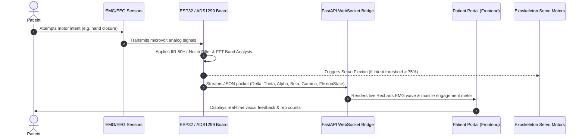
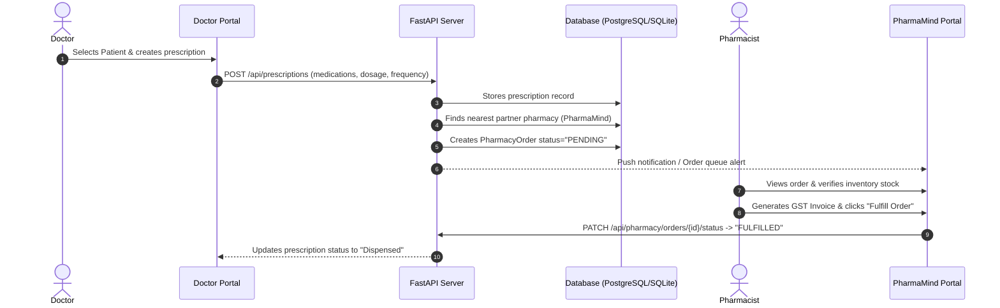

# NeuroStride — System Workflows & Sequence Diagrams

> **Document Version:** 1.0.0  
> **Status:** Active  
> **Created:** 2026-08-11  
> **Owner:** Prathmesh (LTPratham)  
> **Classification:** Internal — Confidential  

---

## 1. Clinical Rehabilitation & Hardware Actuation Workflow

---

## 2. Doctor Prescription & PharmaMind Order Routing Workflow

